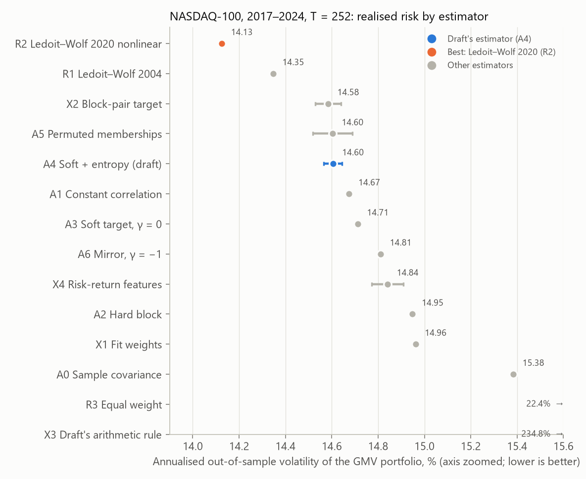
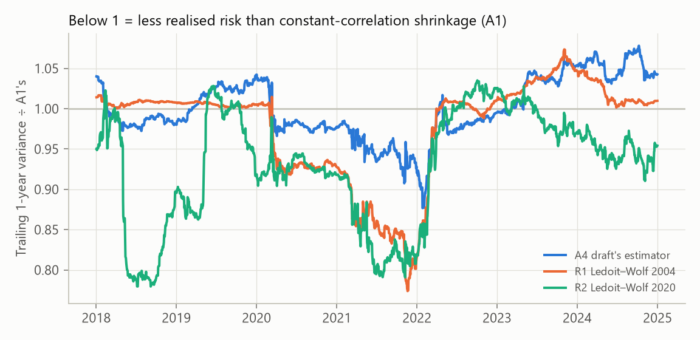
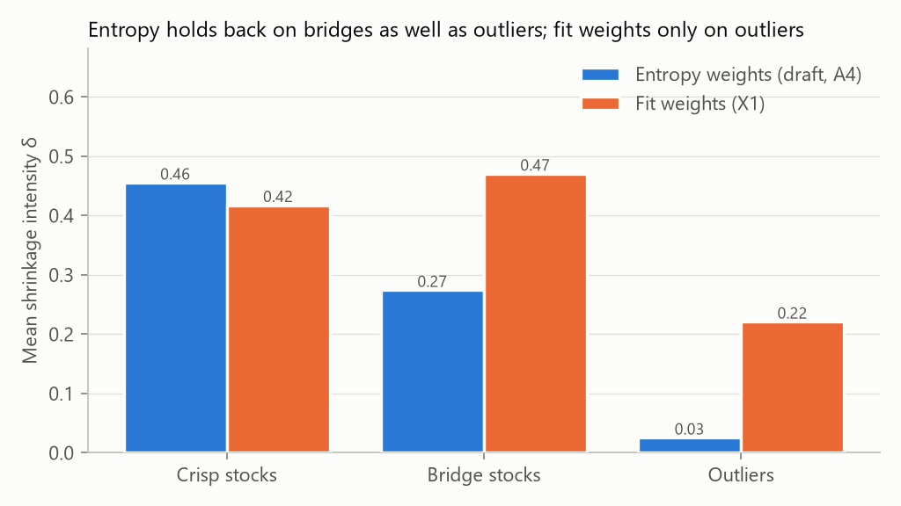
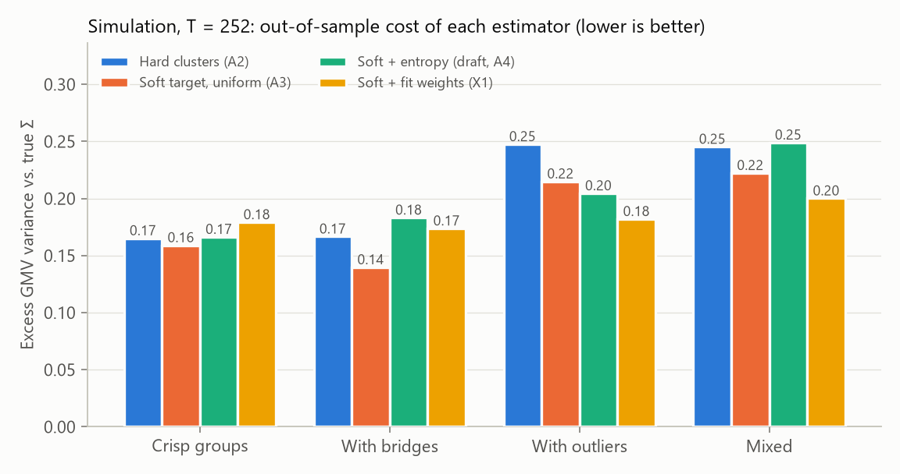

# FuzzShrink

**Reusing what the clustering already knows to measure portfolio risk.**

A Business Economics course project at ABV-IIITM Gwalior. Machine-learning portfolio pipelines group stocks with fuzzy clustering, use the grouping once to pick stocks, and then throw it away. FuzzShrink feeds that grouping into the risk model instead. The aim is a portfolio whose risk on paper is closer to its risk in reality.

> **The result in one paragraph.**
>
> - **The central claim fails on real data.** We fixed our hypotheses before running anything, and on the NASDAQ-100 (2017–2024) the draft's estimator did **not** lower realised risk. It also did no better than the same estimator fed randomly shuffled memberships. By our own pre-committed rule, the central claim is rejected for this market.
> - **Two of our design changes still matter.** The draft's original combination rule blows up (235% annualised volatility); our "angle" rule is safe by construction. Fuzzy memberships also beat hard clusters in every seed.
> - **Clustering adds nothing here.** A simulation shows *when* cluster information can help. The best real-data estimator, Ledoit–Wolf (2020) nonlinear shrinkage, needs no clustering at all.
>
> Details are in [§6](#6-results).

---

## 1. The problem: a portfolio is only as safe as its risk estimate

Anyone allocating money across many assets has to answer one question first: *how do these assets move together?* That answer is a covariance matrix. Everything downstream depends on it: minimum-risk portfolios, risk budgets and hedge ratios.

The difficulty is scale. With 100 stocks there are **4,950 pairwise correlations** to estimate, and a year of daily data gives only about 250 observations for each. Many of the estimated correlations are mostly noise. An optimiser cannot tell noise from signal, so it treats noise as opportunity. It piles into stocks whose risk happened to look low in the sample. Michaud (1989) called mean-variance optimisation an "error maximiser" for exactly this reason.

The result is a portfolio that looks safe on paper and turns out riskier in reality. That gap has an economic price:

- **Higher realised risk** than the investor signed up for.
- **More trading**, because noisy estimates change from month to month and drag the portfolio weights with them. Every trade pays transaction costs.
- **Worse risk-adjusted returns** after those costs.

The standard remedy is **shrinkage** (Ledoit and Wolf, 2004). Blend the noisy sample estimate with a simple, stable "target" structure, in proportions chosen to minimise the expected error. The open question is which target to shrink toward.

## 2. The gap: information that is computed, used once, and thrown away

Recent machine-learning pipelines run in three stages. Our base paper is Dastkhan, Mosaffa and Fabozzi (2026), *Annals of Operations Research*.

1. **Clustering**: fuzzy clustering groups the stocks.
2. **Forecasting**: an LSTM predicts returns.
3. **Allocation**: a genetic algorithm splits the capital.

The fuzzy clustering stage produces a **membership matrix**: for every stock, how strongly it belongs to each group. That is a detailed map of the market. It shows which stocks are clearly "semiconductors", which sit between two groups, and which fit no group at all.

The pipeline uses this map **only to select stocks**. The allocation stage then estimates risk from raw returns as if the clustering had never happened.

In economic terms, this is an investment with an unclaimed return. The clustering has already been paid for, in data and compute, but its output is not used where it would be worth most: in the risk estimate.

## 3. The idea: shrink each stock only as far as its group describes it

FuzzShrink routes the membership matrix into the covariance estimator in two ways.

1. **A soft block target.** When a correlation is too noisy to trust, fall back on the group structure: stocks in the same group move together like their group, and stocks in different groups like the market. Because memberships are fuzzy, a stock can belong partly to two groups (a chip-design firm that is also a cloud business). Its target is then a blend of both groups.
2. **A per-stock intensity.** Shrink a stock toward the group structure *only to the degree that the structure describes it*. A stock that clearly belongs to one group borrows strength from it. A stock that no group explains keeps more of its own sample behaviour.

The estimator is a drop-in replacement for the covariance input of an existing pipeline; nothing else changes. That is what lets any improvement be credited to it alone.

It also **contains the standard estimators as exact special cases**:

- With a single group, it is constant-correlation shrinkage (Ledoit and Wolf, 2004).
- With crisp, one-group-per-stock clustering, it is hard block shrinkage.

So FuzzShrink generalises established methods rather than competing with them.

## 4. What this repository adds beyond the paper draft

The first draft of our paper described the estimator and an evaluation plan. Building it exposed five problems, which this repository fixes. [docs/method.md](docs/method.md) has the details.

| Problem in the draft | What we do now |
|---|---|
| The combined estimate could fail to be a valid covariance matrix, so the draft needed a repair step after the fact. | An **"angle" combination rule** that is a valid covariance matrix **by construction**, with a short proof. The draft's special cases still hold exactly. |
| No condition was given for the target itself to be valid. | **Lemma 1**: the soft target is valid whenever within-group correlation ≥ between-group correlation ≥ 0. |
| The base intensity rule was borrowed from a different target. | **One closed-form rule** that is optimal for each variant's own target and weights, so every comparison is fair. |
| Membership entropy mixes up two kinds of ambiguity. A *bridge* stock (split between two groups) is described well by a soft target; an *outlier* (fitting no group) is not. | A **fit** variant that measures directly how well the target describes each stock. A **direction test** (γ < 0) checks whether the data even agree with the draft's intuition. |
| The base paper clusters on risk-return statistics, but a correlation target needs groups of stocks that move together. | **Co-movement features** (market-neutral principal-component loadings) as the default, with the draft-faithful features kept as a comparison. |

## 5. How we try to prove ourselves wrong

A covariance estimator is easy to oversell with one favourable backtest. Our evaluation is built to falsify the claim if it is false.

- **Pre-registered protocol.** The hypotheses, configurations, metrics, tests and decision rules are in [docs/protocol.md](docs/protocol.md). It was committed *before* any result was computed, and the git history shows the order.
- **A simulation with a known answer.** In a synthetic market where we choose the true groups, bridges and outliers, we can measure exactly when each component helps.
- **A permutation control.** We shuffle which stock gets which membership vector. If the shuffled version does as well, the gain did not come from the clustering, and the claim fails.
- **A mechanism test.** If entropy conditioning works for the reason we say, the risk reduction should concentrate in the most ambiguous stocks.
- **Strong baselines, not just weak ones.** These are sample covariance, Ledoit–Wolf (2004), Ledoit–Wolf (2020) nonlinear shrinkage, the current state of the art for minimum-variance portfolios, and the naive 1/N portfolio.
- **Economic value, not just statistics.** We report how much a mean-variance investor would pay per year, in basis points, to switch from standard shrinkage to FuzzShrink.

## 6. Results

Full tables: [results/backtest/README.md](results/backtest/README.md) (real data), [results/simulation/README.md](results/simulation/README.md) (simulation), [results/backtest/EXPLORATORY.md](results/backtest/EXPLORATORY.md) (post-hoc check), and [results/data/README.md](results/data/README.md) (data quality).

### 6.1 Real data: NASDAQ-100, 2017–2024

Setup: monthly rebalancing of the global minimum-variance (GMV) portfolio, 252-day estimation windows, 83–95 stocks per window, and 10 clustering seeds.



| | Pre-registered hypothesis | Evidence | Verdict |
|---|---|---|---|
| H1 | The draft's estimator (A4) has lower risk than constant-correlation shrinkage (A1) | 14.60% against 14.67%; Holm p = 0.63; 0 of 10 seeds significant | not supported |
| H2 | Any gain comes from the most ambiguous stocks | The most ambiguous quartile's risk contribution *rose* (+29 bps) | not supported |
| H3 | Entropy conditioning beats the soft target alone (A3) | Holm p = 0.63 | not supported |
| H4 | A4 beats the same estimator with **shuffled** memberships (A5) | 14.60% against a shuffled median of 14.59%; p = 0.53 | **not supported: the central claim is rejected** |
| H5 | The draft's direction (γ = +1) beats the mirror (γ = −1) | Holm p = 0.63 | not supported |
| H6 | Fuzzy memberships beat hard clusters (A3 vs A2) | Holm p = 0.004; 10 of 10 seeds | **supported** |

What else the real data showed:

- **The draft's combination rule (X3) is unusable.** Its repair step fired in 20% of windows and left nearly singular matrices; the optimiser took 18× gross leverage, and realised volatility reached **235%**. The angle rule (method §5.2) never needs repair.
- **The best estimator needs no clustering.** Ledoit–Wolf (2020) nonlinear shrinkage reached 14.13%, a 7.4% lower variance than A1 (p = 0.005). Ledoit–Wolf (2004) reached 14.35%.
- **The intensity matters more than the target.** R1 and A1 share the same target and differ only in intensity: Ledoit–Wolf's intensity (0.19) against ours (0.29). That difference alone is worth a 4.4% variance cut.
- **The verdict is robust to the intensity rule** ([post-hoc analysis](results/backtest/EXPLORATORY.md)). With Ledoit–Wolf's intensity, the fuzzy variants tie R1 at best (14.36% against 14.35%), and entropy weighting still loses to its shuffled control (p = 0.89).
- **The sensitivity checks don't change the picture.** Window length (126/504 days), fuzzifier m and the γ grid change none of the conclusions, and long-only constraints shrink the differences between estimators.



### 6.2 Simulation: when *could* cluster information help?

We built a synthetic market with five groups, *bridge* stocks (split between two groups) and *outliers* (no group). It shows exactly where the draft's logic breaks:



- **Entropy can't tell bridges from outliers.** Membership entropy flags bridge stocks (0.54) almost as strongly as outliers (0.94). So the draft's weights stop shrinking bridges, which the soft target already describes well.
- **Fit weights can.** They measure directly how well the target describes each stock, shrink bridges like crisp stocks, and hold back only on outliers.



Pre-registered predictions:

- **S2 holds at both window lengths.** Soft beats hard when bridges exist, and entropy weighting does not help there.
- **S4 holds at both window lengths.** Fit weights are the best membership-based variant in the mixed market.
- **S1 and S3 hold at T = 252 only.**

As validation, the sample covariance's simulated loss matches the textbook (N−1)/(T−N).

### 6.3 Economic value

What a mean-variance investor would pay per year to switch from A1, counting **only the risk reduction**. This is the part an estimator controls; mean-return differences over eight years are mostly noise, and the full ΔCER is in the backtest README.

| Estimator | Ann. volatility | λ = 1 | λ = 5 | λ = 10 (bps/yr) |
|---|---|---|---|---|
| R2 Ledoit–Wolf 2020 | 14.13% | +8 | +40 | +79 |
| R1 Ledoit–Wolf 2004 | 14.35% | +5 | +24 | +48 |
| X2 Block-pair target | 14.58% | +1 | +7 | +13 |
| A4 Draft's estimator | 14.60% | +1 | +5 | +10 |
| A1 Constant correlation | 14.67% | 0 | 0 | 0 |
| A2 Hard clusters | 14.95% | −4 | −20 | −41 |
| A0 Sample covariance | 15.38% | −11 | −53 | −106 |

On a ₹1,000 crore book, 40 bps a year is ₹4 crore. Better risk estimates are worth real money, but only when they actually reduce risk.

### 6.4 What this means

1. **Reusing a by-product is not free value.** The membership matrix is a sunk cost; the economic question is the *marginal* value of reusing it. On this market that value is about zero. Co-movement among NASDAQ-100 stocks is dominated by one market factor, and the group structure fuzzy clustering finds adds nothing measurable beyond a constant-correlation target.
2. **The best alternative sets the bar.** Nonlinear shrinkage, which needs no clustering, delivers the largest risk reduction. Any recycled signal must beat it to be worth deploying.
3. **What survives from FuzzShrink:**
   - if you put clusters into a risk target, make them fuzzy (H6);
   - the angle rule turns a design that can blow up into one that cannot (Proposition 3);
   - the simulation gives a theory of *when* cluster information helps, and of which signal to condition on (fit, not entropy).
4. **The negative result is credible because it was pre-registered.** The draft itself promised to report the permutation control and the mechanism test "whatever they show". We did.

### 6.5 Limitations

- Current constituents only, so the results carry survivorship bias, as in the base paper.
- One market and one period: tech-heavy and mostly a bull market.
- GMV test beds only; the base paper's LSTM and genetic-algorithm pipeline is not reconstructed.
- Monthly rebalancing and a flat 10 bps cost.
- The simulation's market structure is our own design. Real markets with stronger sector structure (e.g. multi-asset or international universes) may behave more like the simulation.

## 7. Repository map

| Path | What it holds |
|---|---|
| `src/fuzzshrink/` | The estimator package. It needs only numpy, scipy and pandas. |
| `scripts/` | Data download, simulation and backtest runners, and figures. |
| `tests/` | Unit tests, including the draft's special-case propositions written as tests. |
| `docs/method.md` | The exact specification of every estimator. |
| `docs/protocol.md` | The pre-registered evaluation protocol. |
| `results/` | Summary tables and figures (stage 6). |

## 8. Reproducing

```bash
python -m venv .venv
.venv/Scripts/activate        # Windows; on Linux or macOS: source .venv/bin/activate
pip install -r requirements.txt
python -m pytest -q
```

Then, in order (about 15 minutes on a 12-core laptop):

```bash
python scripts/download_data.py      # universe + prices (prices are not committed)
python scripts/data_report.py        # results/data/
python scripts/run_simulation.py     # results/simulation/
python scripts/run_backtest.py       # 60 backtests into results/runs/ (not committed)
python scripts/report_backtest.py    # results/backtest/README.md and tables
python scripts/run_exploratory.py    # results/backtest/EXPLORATORY.md (post hoc)
python scripts/make_figures.py       # results/figures/
```

Yahoo Finance data can change slightly over time; the constituent list is pinned in `data/universe/`.

## 9. Team

Hemateja, Neerav Mishra, Srijan Singh, Shivansh Katiyar and Tanushri. Atal Bihari Vajpayee Indian Institute of Information Technology and Management, Gwalior.

## References

- Dastkhan, H., Mosaffa, A., Fabozzi, F. J. (2026). Integrated machine learning framework for dynamic portfolio management: clustering, forecasting, and optimization. *Annals of Operations Research*. https://doi.org/10.1007/s10479-026-07053-9
- Ledoit, O., Wolf, M. (2004). Honey, I shrunk the sample covariance matrix. *Journal of Portfolio Management*, 30(4), 110–119.
- Ledoit, O., Wolf, M. (2020). Analytical nonlinear shrinkage of large-dimensional covariance matrices. *Annals of Statistics*, 48(5), 3043–3065.
- Michaud, R. O. (1989). The Markowitz optimization enigma: is "optimized" optimal? *Financial Analysts Journal*, 45(1), 31–42.
- Schäfer, J., Strimmer, K. (2005). A shrinkage approach to large-scale covariance matrix estimation. *Statistical Applications in Genetics and Molecular Biology*, 4(1).
- Bezdek, J. C. (1981). *Pattern Recognition with Fuzzy Objective Function Algorithms*. Plenum.
