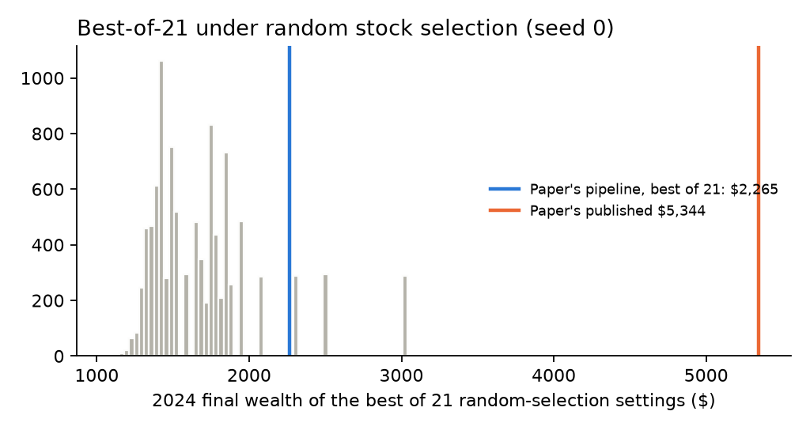
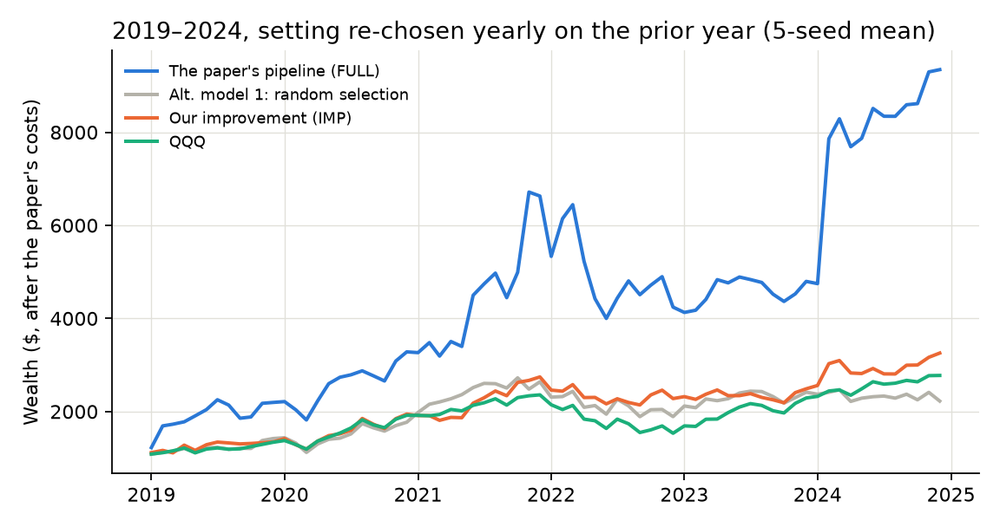

# Higher Returns, Same Sharpe Ratio: A Replication of an Integrated Machine-Learning Portfolio Framework

Hemateja, Neerav Mishra, Srijan Singh, Shivansh Katiyar, Tanushri
Atal Bihari Vajpayee Indian Institute of Information Technology and Management, Gwalior, India

*Draft, November 2026. Every number in this paper is produced by the code and data in this repository; section 9 maps each result to its script.*

---

## Abstract

Dastkhan, Mosaffa and Fabozzi (2026) propose a three-module portfolio framework for Nasdaq stocks:

- fuzzy clustering to select stocks;
- an LSTM network to forecast their returns;
- a genetic algorithm to allocate capital.

They report that $1,000 grew to $5,344 in 2024, with a Sharpe ratio of 11.93 against 0.31 for the Nasdaq-100. We re-examine these claims using their stock universe, their cost assumptions and a reconstruction of their pipeline, under a protocol fixed before any result was computed.

**What we find:**

1. **The published performance table is internally inconsistent.** The reported annual return (565.89%) exceeds the return implied by the reported final wealth (434.4%). The benchmark rows mix monthly and annual units: on consistent units the Nasdaq-100's 2024 Sharpe ratio under the paper's own formula is 2.30, not 0.31.
2. **The reported forecast accuracy (1.67% MAPE) is worse than a random walk** (1.38%). Across 2018–2024, the LSTM's return forecasts have an information coefficient indistinguishable from zero.
3. **The headline is a best-of-21 choice made on the test year itself.** Choosing the configuration on the preceding year instead roughly halves the 2024 result, to the level of the Nasdaq-100.
4. **Over six years with honest annual re-selection, the pipeline does earn high returns** ($1,000 → $9,569 against $2,776 for QQQ). It does so by holding about three stocks at 2.3 times the index's volatility. Its Sharpe ratio (0.97) matches the index (0.93) and does not exceed an equal-weighted portfolio of the same stocks (1.05).
5. **None of the paper's module-contribution claims is statistically significant** over this longer period, although each points in the claimed direction.

We conclude that the framework's apparent outperformance is largely a matter of risk and reporting, not predictive skill.

**Keywords:** replication, portfolio optimization, fuzzy clustering, LSTM, backtest overfitting, Sharpe ratio

---

## 1. Introduction

Machine-learning portfolio frameworks increasingly combine several learned components: clustering to choose assets, deep networks to forecast returns, and metaheuristics to allocate capital. Each component adds tunable choices, and the evaluation usually rests on a single backtest. That combination is exactly where the finance literature has documented the largest gap between reported and reproducible performance (Bailey et al., 2014; Harvey, Liu and Zhu, 2016; Hou, Xue and Zhang, 2020).

Dastkhan, Mosaffa and Fabozzi (2026), published in *Annals of Operations Research*, is a clear and influential instance. Their framework clusters 88 Nasdaq stocks by return and risk, picks one representative per cluster, forecasts each representative's next-month price with an LSTM, and sets weights with a Sharpe-maximising genetic algorithm. Tested on the twelve months of 2024, they report:

- $1,000 → $5,344, after costs;
- a Sharpe ratio of 11.93;
- benchmark Sharpe ratios of 0.35 (Nasdaq Composite) and 0.31 (Nasdaq-100).

A decomposition into three alternative models supports their claim that each module contributes independently.

This paper asks whether those conclusions survive four checks:

1. Are the published figures internally consistent?
2. Do the forecasts show skill?
3. How much of the headline depends on choices made with knowledge of the test year?
4. Do the paper's conclusions hold over a longer period with honest model selection?

We answer with the paper's own tables, the same 85 stocks still available from its universe, its transaction-cost rule, and a reconstruction of its pipeline. The design, hypotheses and decision rules of every computation were committed to a public repository before the computation ran.

**Contributions.**

1. An audit of the published performance table that identifies two arithmetic inconsistencies, both of which inflate the paper's advantage over its benchmarks.
2. Evidence that the reported forecast accuracy does not exceed a random walk, and that the LSTM's return forecasts carry no cross-sectional information.
3. A quantification of test-period selection: best-of-21 against previous-year selection, a random-selection null, and the probability of backtest overfitting.
4. A six-year, honestly re-selected replication of the paper's decomposition analysis. It shows that the pipeline's high returns come with commensurate risk.

## 2. Related work

**Backtest overfitting and multiple testing.** When many strategy variants are tried and the best is reported, its backtest overstates its future performance. Bailey et al. (2014) show how quickly in-sample Sharpe ratios inflate with the number of trials. Bailey and López de Prado (2014) propose the deflated Sharpe ratio, and Bailey et al. (2017) the probability of backtest overfitting (PBO), estimated by combinatorially symmetric cross-validation. White (2000) and Hansen (2005) give formal tests for data snooping. Harvey, Liu and Zhu (2016) argue that new factors should clear t-statistics near 3.

**Replication in empirical finance.** Hou, Xue and Zhang (2020) replicated 452 anomalies and found most do not survive once microcaps are handled consistently. Our study is smaller in scope: a single paper, examined in depth.

**Benchmarks for portfolio rules.** DeMiguel, Garlappi and Uppal (2009) show that the naive 1/N portfolio is hard to beat out of sample, because estimation error in expected returns overwhelms the gains from optimisation. Lo (2002) shows that Sharpe ratios estimated from short samples are highly uncertain. Twelve monthly returns, the base paper's test length, give a standard error of roughly 0.3 on a monthly Sharpe ratio.

**Clustering for portfolio selection.** The base paper builds on a line of work using K-means, fuzzy c-means and hierarchical clustering to diversify asset selection (Nanda et al., 2010; Long et al., 2014; Khan and Mehlawat, 2022). We do not dispute that clustering can aid diversification; we test whether the specific reported gains hold.

## 3. The framework under study

We summarise Dastkhan et al. (2026) from the published article.

- **Data.** 88 Nasdaq-listed stocks with complete data, January 2017 to December 2024. The test period is January–December 2024, with monthly rebalancing on an expanding window that starts in January 2017.
- **Module 1, clustering.**
  - Each stock is described by its historical mean daily return and daily standard deviation.
  - Fuzzy c-means runs with k-means++ initialisation and Mahalanobis distance.
  - One representative per cluster is chosen by one of three criteria: maximum return, maximum Sharpe ratio or minimum risk.
  - The number of clusters (2–8) and the criterion are chosen by "the highest final investor wealth over the test period" (their §3.1 and §4.1).
- **Module 2, forecasting.**
  - An LSTM (two layers of 50 units, dropout 0.2) predicts daily prices for the next month.
  - Inputs are the two most important features by SHAP analysis: close price and moving averages.
  - Accuracy is reported as an average MAPE of 1.67%.
- **Module 3, allocation.**
  - A genetic algorithm maximises expected return over risk, long-only, with zero weights allowed.
  - Population 50, 100 generations, mutation standard deviation 0.05 with probability 0.05, run 10 times per month.
- **Costs.** 0.1% to buy and 0.2% to sell, on the whole portfolio every month.
- **Headline.** Four clusters with maximum-return representatives: $1,000 → $5,344 (Table 7). Alternative models replace clustering with random selection (Alt. 1), forecasts with historical means (Alt. 2), and optimisation with equal weights (Alt. 3); paired t-tests on cumulative returns support every module (Table 11).

## 4. Data and replication design

**Data.** Daily adjusted closes from Yahoo Finance for the 88 stocks in the paper's Appendix 1, January 2017 to December 2024. Three (ANSS, EA and WBD) are no longer available after corporate events, leaving **85**. Our daily mean returns and standard deviations match the paper's Appendix 1 to median absolute differences of 0.00016 and 0.00046. QQQ proxies the Nasdaq-100; ^NDX and ^IXIC are used for the audit.

**Reconstruction (FULL).** We follow the published description, with four necessary choices:

1. **Mahalanobis fuzzy c-means.** It is implemented as Euclidean fuzzy c-means on (mean, standard deviation) whitened by their covariance, which is mathematically equivalent.
2. **The forecaster.** It is a pooled single-layer LSTM (16 units) trained monthly on the previous 504 days to predict the next 21-day return from the last 60 daily returns. The paper used per-stock price LSTMs with SHAP feature selection, whose full details are not published. Section 7 discusses what this implies.
3. **Risk.** The covariance matrix is the sample covariance of all daily returns since January 2017.
4. **The genetic algorithm.** It follows the published configuration exactly.

All randomness (LSTM initialisation, clustering, the genetic algorithm, random selection) is repeated over five seeds.

**Pre-registration.** Each analysis below was specified in a protocol committed before it ran:

- `docs/protocol-2024-replication.md` for section 5.3;
- `docs/protocol-replication-paper.md` for sections 5.2 and 5.4–5.6.

Two clarifications were logged before any result was seen.

**Statistics.**

- **Standard Sharpe ratio:** monthly mean ÷ monthly standard deviation × √12, with a zero risk-free rate.
- **Comparisons:** one-sided t-tests on monthly return differences with Newey–West (HAC) standard errors. Hypotheses count as supported when the median p-value across seeds is below 0.05 and at least three of five seeds point the same way.
- **Multiple testing:** Holm-adjusted p-values are reported alongside.

## 5. Results

### 5.1 The published performance table is internally inconsistent

Table 1 compares the paper's reported annual return with the return implied by its own reported final wealth.

**Table 1.** Reported annual return vs. the return implied by reported final wealth ($1,000 start)

| Row (paper's table) | Reported annual return | Implied by reported wealth | Reported Sharpe | Reported return ÷ reported risk |
|---|---|---|---|---|
| Proposed model, max return (T7) | 565.89% | 434.4% | 11.93 | 11.93 |
| Proposed model, max Sharpe (T7) | 388.45% | 295.8% | 8.95 | 8.95 |
| Proposed model, min risk (T7) | 178.26% | 134.5% | 6.65 | 6.65 |
| Alt. 1, random selection (T10) | 189.00% | 136.9% | 6.20 | 5.91 |
| Alt. 2, historical means (T10) | 23.61% | −0.05% | 0.59 | 0.59 |
| Alt. 3, equal weights (T10) | 88.14% | 55.9% | 2.74 | 2.74 |
| Nasdaq Composite (T7) | 1.37% | 30.4% | 0.35 | 0.35 |
| Nasdaq-100 (T7) | 1.23% | 26.6% | 0.31 | 0.31 |

Two problems follow.

**The returns are overstated.** The paper's Eq. 14–15 compound the *arithmetic* mean monthly return, (1 + R̄)¹² − 1. For volatile portfolios this exceeds the realised compound return, so every model row reports a return above what its own wealth implies. The overstatement grows with volatility, so it flatters the volatile model portfolios more than the benchmarks. Alternative Model 2 shows the problem most clearly: it reports a 23.6% annual return while finishing the year with less money than it started with.

**The benchmark rows use different units.** The indices' "annual" returns of 1.37% and 1.23% contradict their own final wealth (+30.4% and +26.6%). Their "annual risk" of 3.9–4.0% matches the indices' *monthly* volatility in 2024 (3.35% and 3.22%). The 2024 index data put the comparison on one footing:

| | Monthly mean | Monthly s.d. | 2024 return | Wealth with the paper's costs | Sharpe, paper's Eq. 15 | Standard Sharpe |
|---|---|---|---|---|---|---|
| Nasdaq Composite | 2.18% | 3.35% | 28.6% | $1,241 | 2.54 | 2.16 |
| Nasdaq-100 | 1.92% | 3.22% | 24.9% | $1,205 | 2.30 | 1.98 |

On consistent units the paper's 11.93 against 0.31 comparison (38 to 1) becomes:

- **11.93 against 2.30** under the paper's own formula;
- **4.33 against 1.98** under the standard Sharpe ratio, recovered from the moments the paper reports.

That is roughly a 2-to-1 advantage, still large, but based on twelve months (section 5.3).

### 5.2 The forecasts show no measurable skill

**Price accuracy (F1).** For the same 85 stocks in 2024, a random walk, predicting each day's price as the previous day's, has a MAPE of **1.38%**, below the paper's reported 1.67%. For Amazon, the paper's illustrated example, the random walk scores 1.32% against the reported 1.33%.

The paper does not state the forecast horizon behind its MAPE. If its forecasts were genuine month-ahead price paths, 1.67% would beat the month-ahead random walk (4.79%). The paper gives no evidence that they were, and its Figure 3 has the appearance of a one-step-ahead fit. Price-level MAPE is in any case a poor guide to portfolio value, because price levels are dominated by their own persistence.

**Return information (F2).** What matters for allocation is whether forecasts rank next month's returns correctly. Across 84 monthly rebalances (2018–2024), our LSTM's cross-sectional information coefficient averages between −0.009 and +0.005 depending on the seed. No seed is significant (all HAC p > 0.4). This is our forecaster, not theirs; but since the paper reports no return-level accuracy, its claim that the LSTM "improves return forecasting accuracy" rests on price-level fit alone.

### 5.3 The headline is a best-of-21 choice made on the test year

The paper selects the number of clusters and the representative criterion, 21 combinations, by final wealth over 2024, which is also the test year (its Table 6, where wealth ranges from $1,793 to $5,344). We rerun the full 2024 protocol under two rules (Table 2).

**Table 2.** 2024 final wealth from $1,000 (mean of 5 seeds)

| | Configuration chosen on 2024 (as published) | Chosen on 2023, applied to 2024 |
|---|---|---|
| Reconstruction of the paper's pipeline | $2,543 | **$1,201** |
| QQQ, same costs | | $1,211 |
| Equal weight, 85 stocks | | $1,121 |
| Published result | $5,344 | — |

Choosing on the test year roughly doubles the outcome. Chosen honestly, the pipeline ends 2024 level with the Nasdaq-100. Our reconstruction does not reach the published $5,344 even when choosing on the test year; its best seed reaches $3,134. Section 7 discusses possible reasons.

**Is best-of-21 better than chance? (S1).** We repeat the paper's Alternative Model 1 at scale: for each cluster count, 100 random-selection paths per seed, with new random stocks each month and the same forecasts and genetic algorithm. We then compute the distribution of the best of 21 such random configurations. The clustered pipeline's best-of-21 beats this null:

- median p = 0.029 across seeds;
- observed $2,116–$3,014 against a random median of $1,570–$1,718.

On this question **the paper's claim holds**: picking the highest-return representative from each cluster did better than random picking in 2024. The published $5,344, however, lies far beyond anything our reconstruction or its random null produced (Figure 1).

*Figure 1. Best of 21 random-selection configurations in 2024 (seed 0), against our reconstruction's best of 21 and the published figure.*

**How much does picking the best configuration cost out of sample? (S2).** We estimate the probability of backtest overfitting over the 21 configurations' monthly returns, 2018–2024, using 924 combinatorially symmetric splits. PBO ranges from 0.26 to 0.43 across seeds, below the 0.5 that would signal pure overfitting. Selection is therefore informative, but costly: the chosen configuration's Sharpe ratio falls by about 40% out of sample, from a mean monthly 0.41 in-sample to 0.24.

### 5.4 Six years, honestly selected: high returns from high risk

We extend the paper's test to 2019–2024 (72 months), re-selecting the configuration at the start of each year by the previous year's wealth, and rerun its three alternative models the same way (Table 3, Figure 2).

**Table 3.** 2019–2024, configuration re-chosen yearly on the previous year (5 seeds; ± is the s.d. across seeds)

| Pipeline | Final wealth ($1,000) | Sharpe | Max drawdown |
|---|---|---|---|
| Paper's pipeline (FULL) | $9,569 ± 4,193 | 0.97 ± 0.15 | −44.2% |
| Alt. 1: random selection | $2,166 ± 1,097 | 0.48 ± 0.26 | −45.3% |
| Alt. 2: historical means instead of LSTM | $5,033 ± 1,326 | 1.00 ± 0.16 | −34.6% |
| Alt. 3: equal weights instead of GA | $5,491 ± 420 | 0.92 ± 0.03 | −49.3% |
| QQQ | $2,776 | 0.93 | −35.0% |
| Equal weight, all 85 stocks | $3,082 | 1.05 | −27.4% |

*Figure 2. Wealth paths, 2019–2024, average over seeds.*

The pipeline's wealth outcome is striking: more than three times QQQ's. Its risk profile explains it (exploratory, not pre-registered):

- **Concentration:** it holds 3.2 stocks on average.
- **Volatility:** 47.7% annualised, 2.3 times QQQ's 20.6%.
- **Beta:** 1.10 against QQQ.

Per unit of risk it does no better than the market. Its Sharpe ratio is 0.97 against 0.93 for QQQ and 1.05 for simply holding all 85 stocks equally, and its worst drawdown is −44% against −35% and −27%.

The paper's decomposition claims (D1–D3) point in the right direction over six years. Each module raises *returns* in at least four of five seeds. But **none is statistically significant**:

| Claim | Return gap | Median p | Holm p | Verdict |
|---|---|---|---|---|
| D1: clustering beats random selection | +30.3 pp/yr | 0.058 | 0.29 | not supported |
| D2: LSTM beats historical means | +15.0 pp/yr | 0.094 | 0.38 | not supported |
| D3: GA beats equal weights | +11.0 pp/yr | 0.105 | 0.38 | not supported |
| D4: pipeline beats QQQ | +27.4 pp/yr | 0.038 | 0.23 | supported by the pre-registered rule; not after Holm adjustment |

The return gaps are large because the strategy is volatile, but the same volatility makes them statistically indistinguishable from zero. Alternative Model 2, which drops the LSTM, has a slightly *higher* Sharpe ratio (1.00) and a smaller drawdown. That is consistent with section 5.2: the forecasts add risk, not information.

### 5.5 A diversified variant lowers risk but does not raise the Sharpe ratio

We also tested one fixed improvement drawing on our earlier work:

- three stocks per cluster instead of one;
- forecasts shrunk halfway toward their cross-sectional mean;
- Ledoit–Wolf (2020) nonlinear covariance shrinkage;
- an exact maximum-Sharpe solver with a 30% cap per stock.

It roughly halved volatility (24.7%) and drawdown (−25.0%), but its Sharpe ratio (0.90) was no higher. It did not beat the paper's pipeline on returns (I1, p = 0.92), nor QQQ significantly (I2, p = 0.45).

In a separate pre-registered comparison over 2018–2024 with 20-stock, capped portfolios (the repository's stage 7), the same changes did beat the reconstructed pipeline: Sharpe 0.68 against 0.58, with significantly lower volatility. That result, however, also trailed equal weighting. Neither variant turns the framework into a reliable source of risk-adjusted outperformance.

## 6. Discussion

**What survives.** Selecting the highest-return stock from each cluster beat random selection in 2024 (S1). Over six years, the pipeline's returns exceeded the index's in every seed. A practitioner seeking high-risk, concentrated exposure to recent Nasdaq winners could use the framework and would, over 2019–2024, have been paid for that risk.

**What does not.** The paper's central evidence, a 38-to-1 Sharpe advantage and a five-fold increase in wealth over one year, does not survive three checks:

- consistent units (section 5.1);
- honest configuration choice (section 5.3);
- a longer test period (section 5.4).

The forecasting module shows no evidence of skill (section 5.2), and the module-contribution claims are not statistically supported over six years.

**Why this matters for operations research in finance.** The framework is a sensible engineering composition, but its evaluation followed a pattern that systematically flatters complex pipelines:

- a single year;
- configuration selected on the test data;
- metrics that reward volatility;
- benchmarks reported in different units;
- significance tests on cumulative returns, which are strongly autocorrelated.

None of these is unusual, which is why replication is worthwhile. We suggest four minimal reporting standards for such frameworks:

1. Select configurations only on data before the test period.
2. Report the standard Sharpe ratio, and compute benchmarks with the same code as the strategy.
3. Report volatility, drawdown and the number of holdings next to returns.
4. Test on several years, against equal weighting as well as an index.

## 7. Limitations

- **Our forecaster differs from the paper's.** The paper's per-stock price LSTMs with SHAP feature selection are not fully specified and its code is not public. A better forecaster could change the absolute performance of the pipeline, though not the audit in section 5.1, the selection effect in section 5.3, or the risk-adjusted comparison in section 5.4.
- **The published $5,344 was not reproduced.** It may depend on details we could not recover.
- **Three of the 88 stocks are unavailable.** Both the paper and this study use current constituents and therefore share survivorship bias.
- **Short samples.** Six years of monthly data give limited power; the 2024-only comparisons give very little.

## 8. Conclusion

Re-examined with its own data, costs and design, the framework of Dastkhan, Mosaffa and Fabozzi (2026) earns high returns by taking concentrated, volatile positions in a strongly rising market. It does not earn higher risk-adjusted returns than the index or than equal weighting, its forecasts show no measurable skill, and its headline figures are inflated by arithmetic and selection choices.

The broader lesson is economic: a pipeline's value is the return it adds *per unit of risk*, after its configuration is chosen without knowledge of the future. By that standard, simple diversified portfolios remain the benchmark that machine-learning frameworks must beat.

## 9. Reproducibility

| Result | Script | Output |
|---|---|---|
| Table 1, benchmark recomputation, F1 | `scripts/audit_paper_tables.py` | `results/replication_paper/audit.md` |
| Table 2 | `scripts/replicate_2024.py`, `scripts/report_replication.py` | `results/replication_2024/` |
| S1, S2, F2, Table 3, sections 5.4–5.5 | `scripts/walkforward_paper.py`, `scripts/random_null_2024.py`, `scripts/report_replication_paper.py` | `results/replication_paper/` |
| Stage 7 comparison | `scripts/compare_base.py`, `scripts/report_compare_base.py` | `results/base_comparison/` |

Protocols are in `docs/`, committed before each computation.

## References

- Bailey, D. H., Borwein, J. M., López de Prado, M., & Zhu, Q. J. (2014). Pseudo-mathematics and financial charlatanism: The effects of backtest overfitting on out-of-sample performance. *Notices of the American Mathematical Society*, 61(5), 458–471.
- Bailey, D. H., Borwein, J. M., López de Prado, M., & Zhu, Q. J. (2017). The probability of backtest overfitting. *Journal of Computational Finance*, 20(4), 39–69. https://doi.org/10.21314/JCF.2016.322
- Bailey, D. H., & López de Prado, M. (2014). The deflated Sharpe ratio: Correcting for selection bias, backtest overfitting, and non-normality. *Journal of Portfolio Management*, 40(5), 94–107.
- Dastkhan, H., Mosaffa, A., & Fabozzi, F. J. (2026). Integrated machine learning framework for dynamic portfolio management: Clustering, forecasting, and optimization. *Annals of Operations Research*. https://doi.org/10.1007/s10479-026-07053-9
- DeMiguel, V., Garlappi, L., & Uppal, R. (2009). Optimal versus naive diversification: How inefficient is the 1/N portfolio strategy? *Review of Financial Studies*, 22(5), 1915–1953.
- Hansen, P. R. (2005). A test for superior predictive ability. *Journal of Business & Economic Statistics*, 23(4), 365–380.
- Harvey, C. R., Liu, Y., & Zhu, H. (2016). … and the cross-section of expected returns. *Review of Financial Studies*, 29(1), 5–68.
- Hou, K., Xue, C., & Zhang, L. (2020). Replicating anomalies. *Review of Financial Studies*, 33(5), 2019–2133. https://doi.org/10.1093/rfs/hhy131
- Khan, A. Z., & Mehlawat, M. K. (2022). Dynamic portfolio optimization using technical analysis-based clustering. *International Journal of Intelligent Systems*, 37(10), 6978–7057.
- Ledoit, O., & Wolf, M. (2020). Analytical nonlinear shrinkage of large-dimensional covariance matrices. *Annals of Statistics*, 48(5), 3043–3065.
- Lo, A. W. (2002). The statistics of Sharpe ratios. *Financial Analysts Journal*, 58(4), 36–52.
- Long, N. C., Wisitpongphan, N., Meesad, P., & Unger, H. (2014). Clustering stock data for multi-objective portfolio optimization. *International Journal of Computational Intelligence and Applications*, 13(2), 1450011.
- Nanda, S. R., Mahanty, B., & Tiwari, M. K. (2010). Clustering Indian stock market data for portfolio management. *Expert Systems with Applications*, 37(12), 8793–8798.
- Newey, W. K., & West, K. D. (1987). A simple, positive semi-definite, heteroskedasticity and autocorrelation consistent covariance matrix. *Econometrica*, 55(3), 703–708.
- White, H. (2000). A reality check for data snooping. *Econometrica*, 68(5), 1097–1126.
