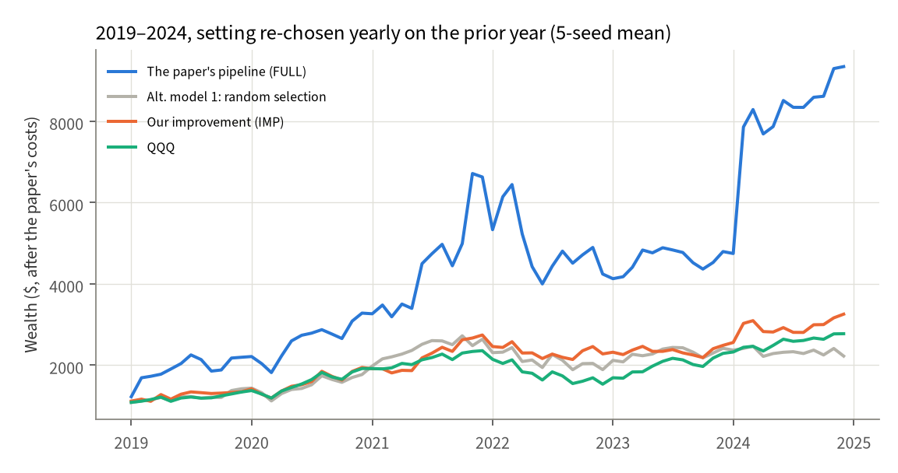
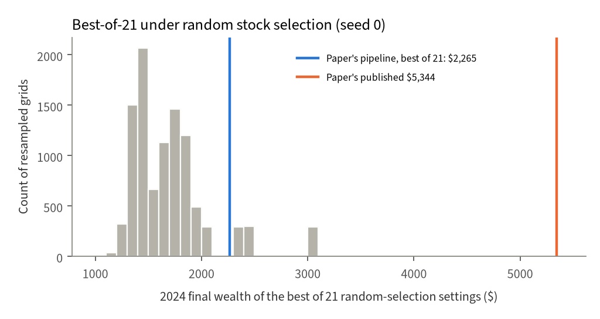

# Stage 9 results: the replication study (paper 2)

Generated by `scripts/report_replication_paper.py`. Design fixed in advance: `docs/protocol-replication-paper.md`.
85 of the paper's 88 stocks, the paper's costs, 5 seeds. Q1 and F1 are in [audit.md](audit.md).

## Q4–Q5: the paper's decomposition over six years, with honest annual selection (2019–2024, 72 months)

| Pipeline | Final wealth ($1,000 in 2019) | Sharpe | Max drawdown |
|---|---|---|---|
| The paper's pipeline (FULL) | $9,569 ± 4,193 | 0.97 ± 0.15 | -44.2% |
| Alt. model 1: random selection | $2,166 ± 1,097 | 0.48 ± 0.26 | -45.3% |
| Alt. model 2: historical means | $5,033 ± 1,326 | 1.00 ± 0.16 | -34.6% |
| Alt. model 3: equal weights | $5,491 ± 420 | 0.92 ± 0.03 | -49.3% |
| Our improvement (IMP) | $3,255 ± 745 | 0.90 ± 0.11 | -25.0% |
| QQQ | $2,776 | 0.93 | -35.0% |
| Equal weight, 85 stocks | $3,082 | 1.05 | -27.4% |

± is the standard deviation across seeds.

| ID | Hypothesis | Mean gap | Median HAC t | Median p | Holm p | Seeds with a positive gap | Verdict |
|---|---|---|---|---|---|---|---|
| D1 | The paper's pipeline (FULL) > Alt. model 1: random selection (clustering adds value) | +30.3 pp/yr | t = +1.59 | 0.058 | 0.291 | 5/5 | not supported |
| D2 | The paper's pipeline (FULL) > Alt. model 2: historical means (the LSTM adds value) | +15.0 pp/yr | t = +1.33 | 0.094 | 0.376 | 5/5 | not supported |
| D3 | The paper's pipeline (FULL) > Alt. model 3: equal weights (the optimiser adds value) | +11.0 pp/yr | t = +1.27 | 0.105 | 0.376 | 4/5 | not supported |
| D4 | The paper's pipeline (FULL) > QQQ (beats the Nasdaq-100) | +27.4 pp/yr | t = +1.80 | 0.038 | 0.229 | 5/5 | supported |
| I1 | Our improvement (IMP) > The paper's pipeline (FULL) (our improvement beats the paper's pipeline) | -24.2 pp/yr | t = -1.41 | 0.919 | 0.919 | 0/5 | not supported |
| I2 | Our improvement (IMP) > QQQ (our improvement beats the Nasdaq-100) | +3.2 pp/yr | t = +0.12 | 0.450 | 0.901 | 4/5 | not supported |

## Q2, F2: does the LSTM forecast next-month returns? (2018–2024, 84 months)

| Seed | Mean information coefficient | HAC t | One-sided p |
|---|---|---|---|
| 0 | +0.0015 | +0.07 | 0.472 |
| 1 | -0.0094 | -0.45 | 0.671 |
| 2 | -0.0072 | -0.35 | 0.637 |
| 3 | +0.0046 | +0.22 | 0.413 |
| 4 | +0.0008 | +0.04 | 0.486 |

Verdict F2: not supported (0/5 seeds with p < 0.05).

## Q3, S1: is the best-of-21 2024 result better than best-of-21 random selection?

| Seed | Paper's pipeline, best of 21 | Random selection, best of 21: median | 95th percentile | p = P(random ≥ observed) |
|---|---|---|---|---|
| 0 | $2,265 | $1,643 | $2,496 | 0.087 |
| 1 | $2,116 | $1,718 | $2,030 | 0.029 |
| 2 | $2,463 | $1,570 | $2,026 | 0.000 |
| 3 | $3,014 | $1,607 | $2,014 | 0.000 |
| 4 | $2,373 | $1,714 | $2,136 | 0.029 |

Verdict S1: supported (median p = 0.029). The paper's published $5,344 is shown in the figure for reference.

## Q3, S2: probability of backtest overfitting (21 settings, 2018–2024, 924 splits)

| Seed | PBO | Mean in-sample Sharpe of the chosen setting | Its mean out-of-sample Sharpe |
|---|---|---|---|
| 0 | 0.36 | 0.399 | 0.213 |
| 1 | 0.26 | 0.429 | 0.295 |
| 2 | 0.42 | 0.383 | 0.212 |
| 3 | 0.39 | 0.408 | 0.243 |
| 4 | 0.43 | 0.418 | 0.254 |

Sharpe ratios here are monthly (not annualised). PBO above 0.5 means choosing the best setting
in-sample is more likely than not to give below-median performance out of sample.
